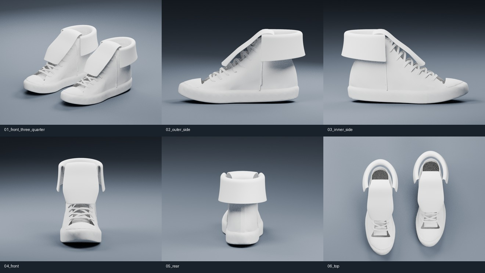

# ONWARD V3 — reference-fitted structure study



This is an editable **shape-review prototype**, not a measured production last or an exact reconstruction. Six retail photographs provide perspective views, not calibrated orthographic measurements. No colors, brand text, prints, stars, logos or accessories from those photographs are reproduced.

## Reference analysis

The six supplied photographs remain in the repository-root ZIP, outside website public assets. The build does not use them as textures.

1. **01_side_toe_left.jpg**: near-flat sole, low rubber cap and an ankle cuff folded outward/downward. The cuff is a continuous rear/side wrap, with the front corner hanging lower than the rear. Preserve the original toe/sole; fit a soft U-shaped fold around the ankle.
2. **02_side_toe_right.jpg**: confirms the wrap on the opposite side. Folded cuff is wider than the upper under it; it must not be a flat floating patch. No side graphics or round accessories are copied.
3. **03_front_three_quarter.jpg**: the wide tongue bends forward over the upper lace rows. Tongue and ankle cuff are separate pieces; the front remains open around the tongue.
4. **04_extended_tongue.jpg**: the extended shoe shows that tongue and collar have real continuation into the shoe. Use a continuous tongue profile rooted beneath the laces, rising to a rounded reversal and draping forward. This study delivers the folded pose, not a rigged folded/unfolded animation.
5. **05_top_front_view.jpg**: rounded rectangular tongue, open ankle cavity and two separated cuff ends. Do not close the opening with a solid cylinder or connect the cuff across the tongue.
6. **06_rear_heels.jpg**: the rear wrap hangs above the heel patch and has a rounded fold ridge with shallow uneven drape. Preserve the source heel structure; omit all reference lettering and decorations.

## Construction and comparison

- V2 original GLB is retained byte-for-byte and continues to be the website's configured asset. No website source, layout, animation or product configuration is changed in V3.
- Retains the first source shoe's actual rubber cap, outsole, foxing, upper panels, laces/eyelets and heel elements. Existing disconnected surfaces are split into named objects. Original upper geometry is not replaced with primitive solids.
- Removes the original narrow, upright tongue island. Builds an independent wide tongue midsurface along a smooth interpolated folded profile, with transverse crown, rounded end, closed 1.8 mm nominal thickness and softened edges.
- Adds an independent open-front U-wrap cuff midsurface. Its curved cross-section rises from an inner attachment zone, turns over an explicit 6 mm-radius return fold, widens around the shell and drapes down to a sloping hem. Closed nominal thickness is 2.4 mm. Tiny smooth geometric irregularity provides fabric drape, not printed motifs.
- The original lower tongue is replaced as part of the complete tongue object, with its root continuing beneath the laces. Existing laces and eyelets remain a grouped object per shoe, rather than falsely claiming individually rigged eyelets.
- Builds a mirrored second shoe in a spaced neutral review pose, rather than retaining the V2 pair's angled placement.
- Existing materials are assigned one neutral untextured white study material. No final palette or patterns. This material assignment is only for the new V3 asset.

## Files and reproduction

- `public/assets/soulgrain_onward_v3_shape_study.glb`: new standalone review model, never substituted into website configuration automatically.
- `modeling/v3/soulgrain_onward_v3_shape_study.blend`: editable cloth midsurfaces and unapplied subdivision / solidify / edge-softening modifiers; named base components, cameras and lighting. Studio floor/lights are not exported.
- `modeling/v3/build_model.py`: deterministic Blender modeling/export/render script, resolves all paths relative to itself.
- `modeling/v3/previews/`: six named studio renders; side/front/rear focus on one shoe so the pair does not hide critical geometry. Three-quarter/top show both shoes.
- `modeling/v3/comparison.json`: source/output file hashes, mesh and triangle counts.
- `modeling/v3/validation.json`: geometry and independent re-import checks.
- `modeling/v3/parts.json`: exact exported-object inventory, evaluated counts, bounds, thickness metadata and non-manifold edge counts.

```sh
blender -b -t 2 --python-exit-code 1 --python modeling/v3/build_model.py
```

For fast geometry-only iteration, append `-- --skip-render`; existing previews are then stale until a full render run.

```sh
blender -b -t 1 --python-exit-code 1 --python modeling/v3/validate_model.py
```

Requires Blender 4.3 with bundled Python and glTF importer/exporter, CPU Cycles renderer. No pip modules or external textures are needed. Rerun overwrites only generated V3 assets, renders, inventory and Blender project; it never changes the V2 source GLB. Cycles denoising is disabled because this environment's Blender lacks OpenImageDenoise.

## Review limits

The reference provides no physical scale, hidden seam topology, pattern pieces, cross-section thickness or exact asymmetric last. All new thicknesses and profile fits are explicit estimates. This study must be reviewed against a measured physical sample before calling it production-accurate. It is not a sewing pattern, watertight whole shoe or manufacturing CAD deliverable. Original imported shells may have open boundaries; that must be distinguished from closed new cuff/tongue parts. Object attachment contact is not the same as destructive mesh fusion.

## Source license

Base model: **theunclerulez**, [Generic “Converse style” Sneakers](https://sketchfab.com/3d-models/generic-converse-style-sneakers-f7858a5612504c4193ca4c61125d6244), [CC BY 4.0](https://creativecommons.org/licenses/by/4.0/). V2 supplied a modified white material. V3 additionally changes the tongue geometry, adds a folded cuff, separates components, assigns a neutral white study material and mirrors/repositions the pair. This attribution applies to the derivative GLB and Blender project. No endorsement is implied.


## Independent parts and validation

Both shoes use the `L_` / `R_` prefix. Exact per-object values are in `parts.json`.

| Component group | Object suffixes | Treatment |
| --- | --- | --- |
| Tongue | `FoldDownTongue` | New folded shell, 1.8 mm thickness |
| Cuff | `FoldDownCuff` | New open-front wrap, 2.4 mm thickness |
| Upper | `UpperOuter`, `UpperInner`, `LiningOuter`, `LiningInner` | Preserved source panels |
| Sole / rubber | `Outsole`, `RubberToeCap`, `FoxingOuter`, `FoxingInner`, `ToeTrim`, `HeelRubber` | Preserved source geometry |
| Laces / eyelets | `LacesAndEyelets` | Source detail retained as one grouped object per shoe |
| Heel / bindings | `HeelSeam`, `HeelSeamInner`, `CollarBinding`, remaining named bindings/details | Preserved source surfaces |

Blender validation checks the V2 SHA-256, non-manifold and zero-area faces and disjoint-triangle self-intersections on the four new solids, BVH intersections between cuff/tongue and between each new part and retained source components, independent re-import of all 56 GLB mesh objects and absence of image textures/cameras/lights in the deliverable. Detailed results are in `validation.json`. BVH checks are a numerical diagnostic, not a claim of certified CAD tolerances or perfect fabric simulation. Existing source-part intersections are not reclassified as new construction failures.

Manual correction history: the first tongue-root profile sat above the laces and crossed the upper. It was lowered/narrowed beneath the original lace path and given a later return fold. The cuff front opening was widened to eliminate cuff/tongue overlap. New-part collision counts were rerun after these changes. The final renders must be reviewed for the resulting approximate fit, not treated as approval of an exact physical pattern.

The final folded tongue was additionally shortened and lowered using the source lace-height envelope, correcting an excessive air gap found in side-view review. The GLB was also loaded in the existing browser renderer via a test-only URL response substitution: 56 mesh objects, four fold parts and zero idle frames were observed. No website configuration file was changed by that test.

A tight early cuff crown also produced internal offset intersections. It was replaced with an explicit 6 mm return radius (larger than the shell thickness); all four new solids are checked for self-intersections after evaluated modifiers.

Final reproduction check: a geometry-only rerun produced the same GLB SHA-256 as the full six-render run. All six PNG previews were visually inspected; both shoes are shown in the three-quarter/top frames, with isolated side/front/rear views for visibility.
