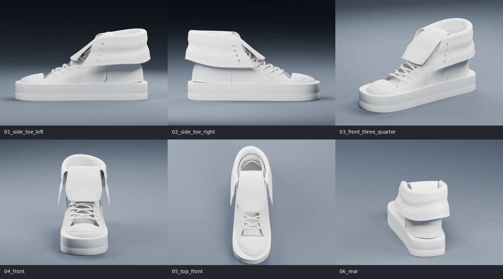

# ONWARD V3 · 单只完整鞋修订

**当前为未通过照片相似度验收的单鞋候选，不是最终高精度还原模型。**



[照片与渲染并排对照](single/comparisons/overview.jpg) · [完整建模说明、差距和估计项](single/README.md)

## 当前交付入口

- [单鞋 GLB](../../public/assets/soulgrain_onward_v3_single_review.glb)
- [可编辑 Blender 工程](single/soulgrain_onward_v3_single_review.blend)
- [六张渲染](single/previews/)
- [逐图照片对照](single/comparisons/)
- [独立 360° 本地审阅工具](review/index.html)（须用 Vite 服务打开，GitHub 文件预览不能运行它）
- [建模脚本](build_single_shoe.py)、[几何验证](validate_single_shoe.py)、[生成对比图](create_single_comparisons.py)
- [独立部件清单](single/parts.json)、[文件比较](single/comparison.json)、[几何检查](single/validation.json)、[形似评审记录](single/visual-review.json)

采用统一中性浅灰白材质。重配辅助鞋身、重建橡胶底、短宽外翻鞋舌、不规则下垂翻筒、内层连接和结构鞋眼。照片是主要形状依据，原 GLB 为辅助。所有参考图的文字、图案、颜色和装饰都不复制。

```sh
blender -b -t 2 --python-exit-code 1 --python modeling/v3/build_single_shoe.py
blender -b -t 1 --python-exit-code 1 --python modeling/v3/validate_single_shoe.py
python3 modeling/v3/create_single_comparisons.py
```

360° 检查：在仓库运行 `npm run dev`，打开服务器路径 `/modeling/v3/review/`。iPad 局域网使用方法见[说明](single/README.md)。工具支持本机 GLB 文件选择，不上传文件；没有部署网站。

上一版双鞋 GLB、Blender 工程和脚本保留作历史对照，已经被本轮目标否决。V2 原始模型、网站源码、动画、布局和模型引用均未修改。

当前程序曲面拟合还没有达到参考图的布料褶皱、接触关系和局部鞋楦精度。几何检查与浏览器显示通过不等于形似通过；需要进一步人工雕刻、重拓扑和逐视角校形。详见当前说明中的逐项差距，没有虚构相似度百分比。

基础模型：**theunclerulez**，[Generic “Converse style” Sneakers](https://sketchfab.com/3d-models/generic-converse-style-sneakers-f7858a5612504c4193ca4c61125d6244)，[CC BY 4.0](https://creativecommons.org/licenses/by/4.0/)。本轮修改了几何与中性白模材质，具体改动见交付说明。
