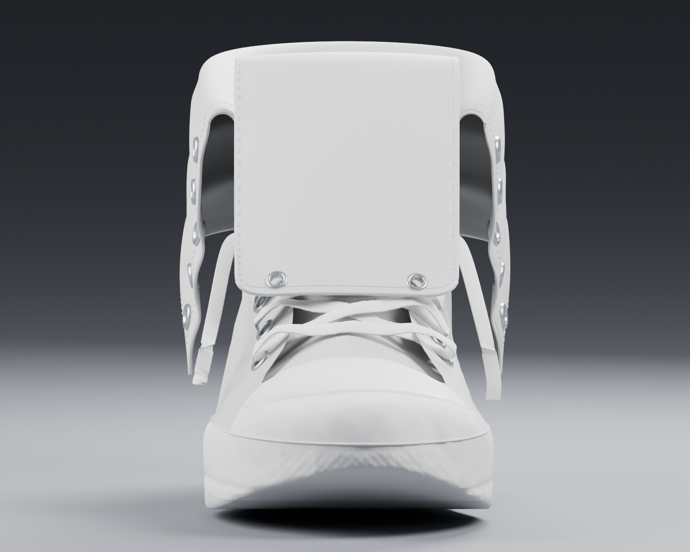
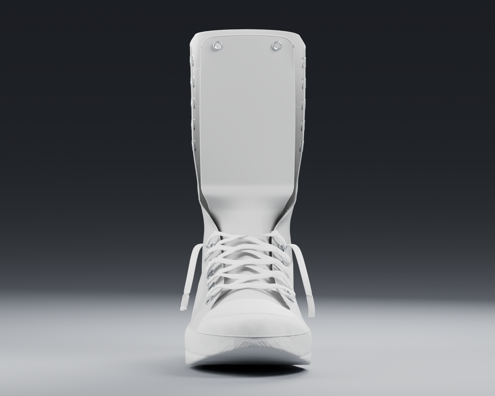
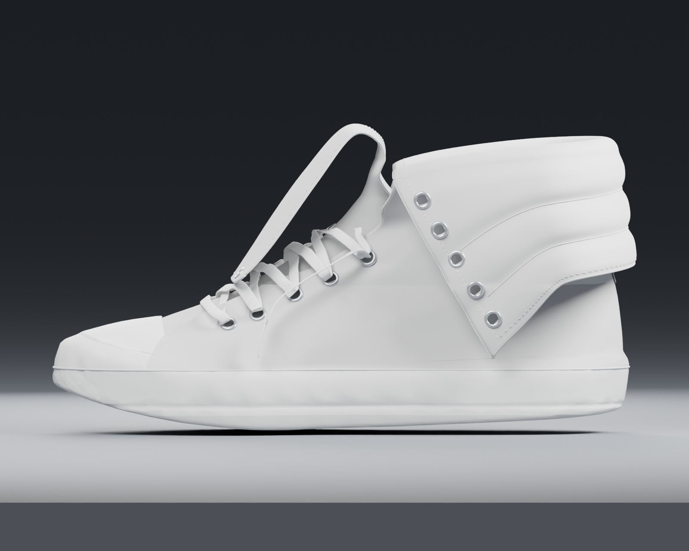
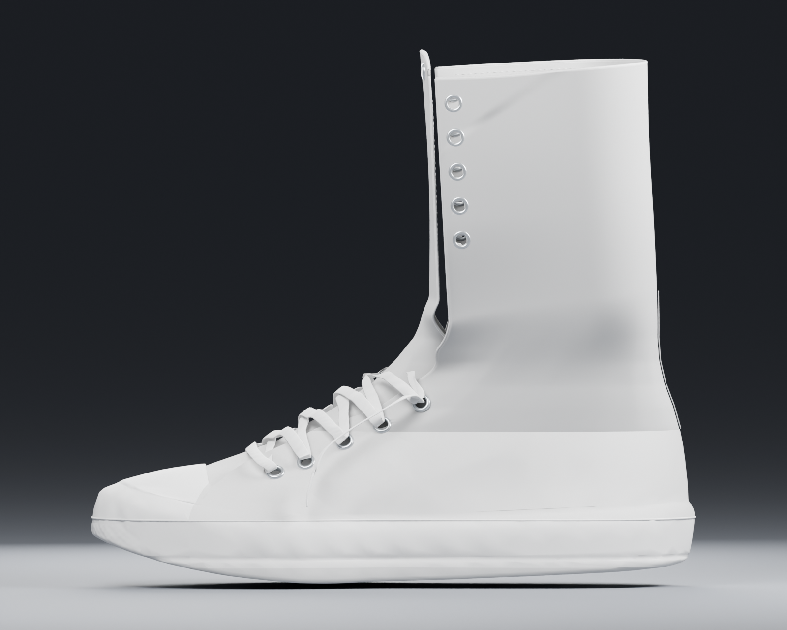
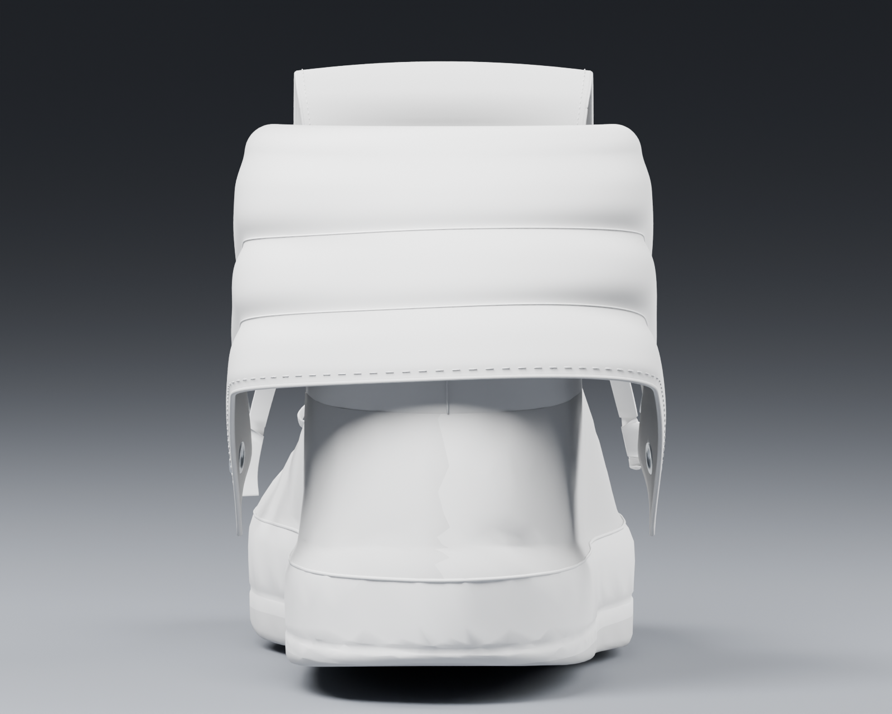
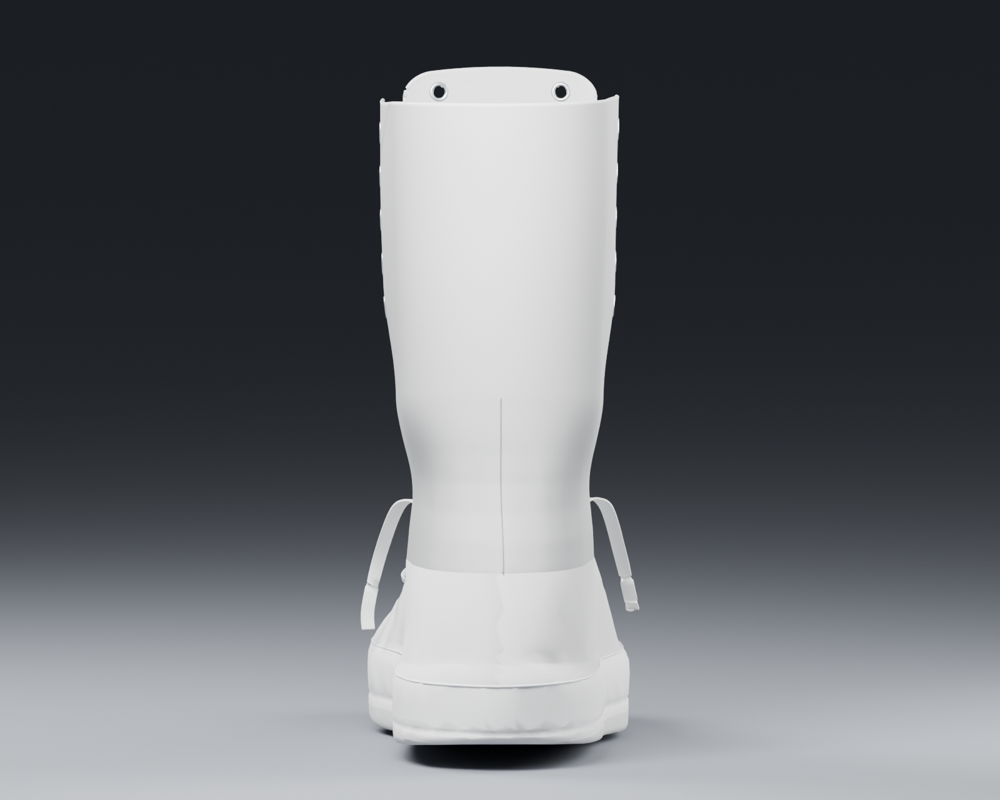
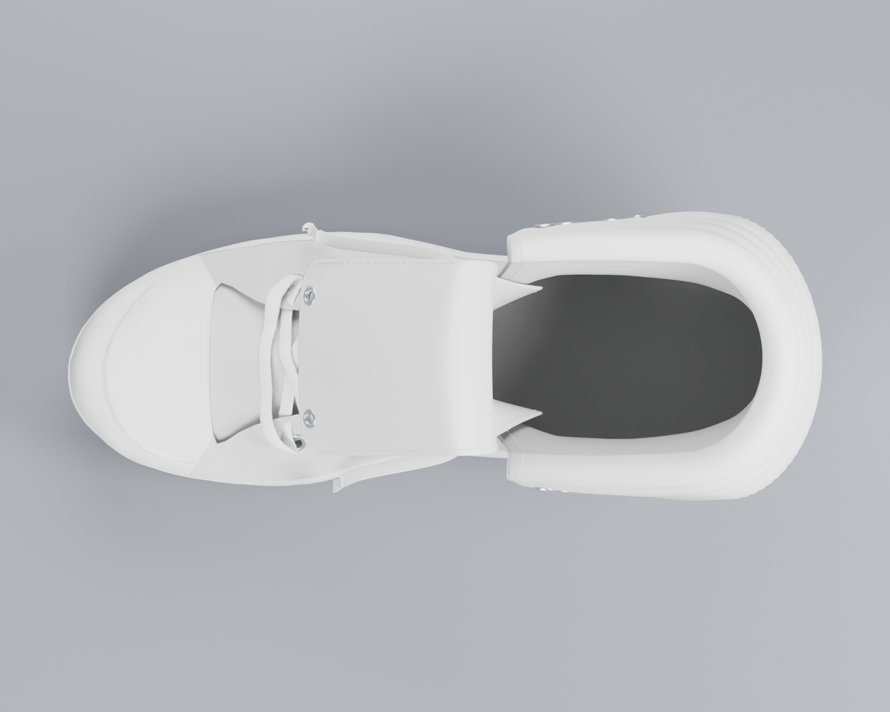
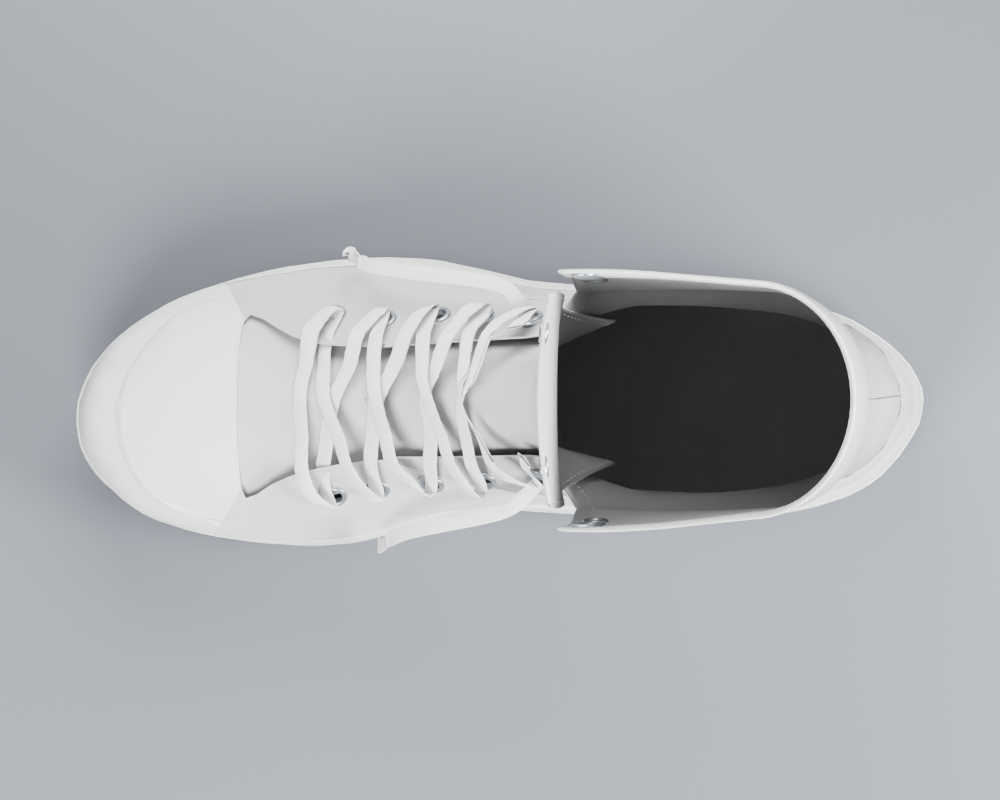
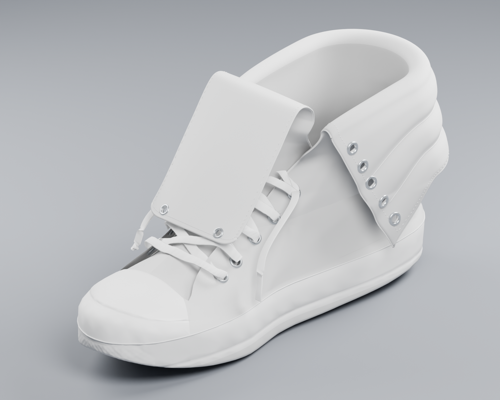
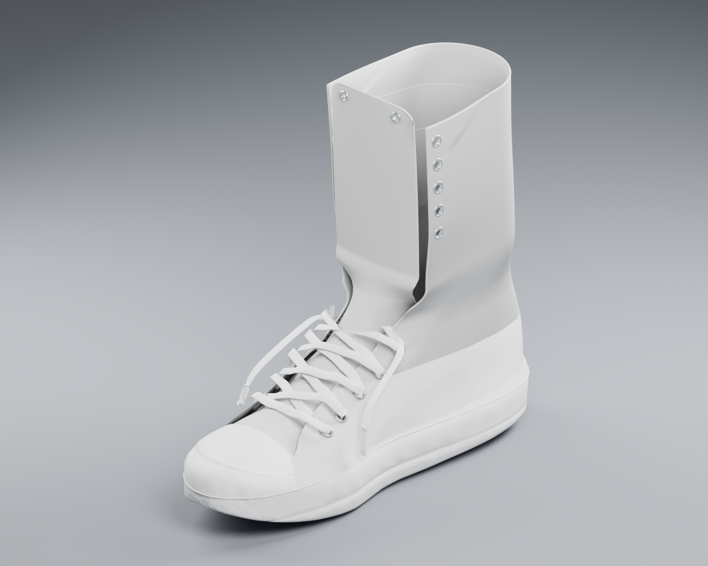

# V7 设计审查图

现有 V7 的两种形态，各五个视角，原尺寸 **1600 × 1280 PNG**。使用 Blender 5.2.2 渲染，仅在内存中切换形态和设置摄影棚；鞋型、GLB、Blender 工程及网站代码均未修改。

这是独立网页预览暂时受阻时的静态审查图片，不能旋转模型。点击任一图片可单独查看、放大或下载。

| 视角 | 外翻折下 | 高帮展开 |
| --- | --- | --- |
| 正面 |  |  |
| 侧面 |  |  |
| 背面 |  |  |
| 俯视 |  |  |
| 45° |  |  |

模型仍为原 V7，15 个材质区域、外翻／展开形态及工作台的换色、印花功能均保留。本次图片不会更新正式网站。

基础模型：theunclerulez，[Generic “Converse style” Sneakers](https://sketchfab.com/3d-models/generic-converse-style-sneakers-f7858a5612504c4193ca4c61125d6244)，[CC BY 4.0](https://creativecommons.org/licenses/by/4.0/)。V7 已修改几何与中性材质，来源不代表原作者对 SoulGrain 的认可。
