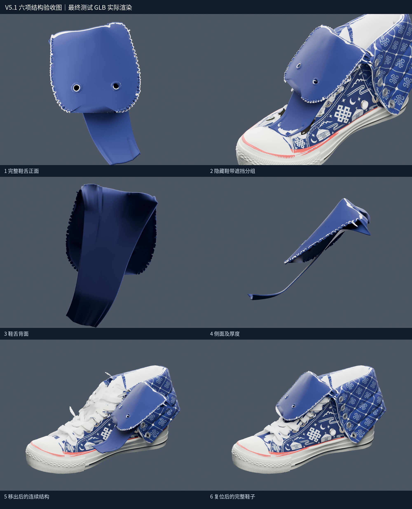
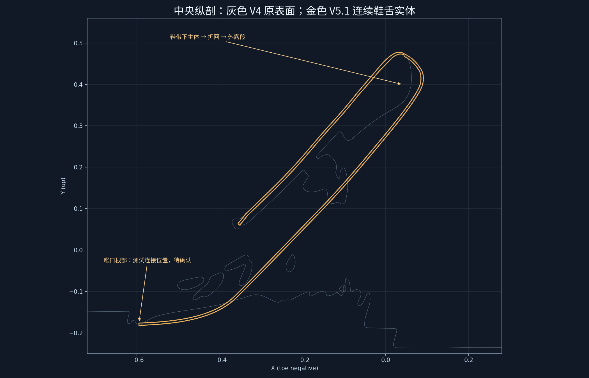
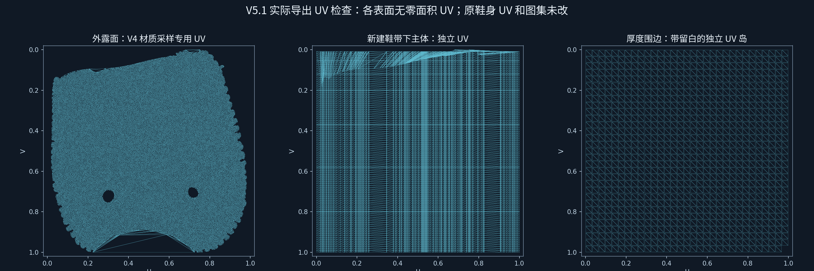
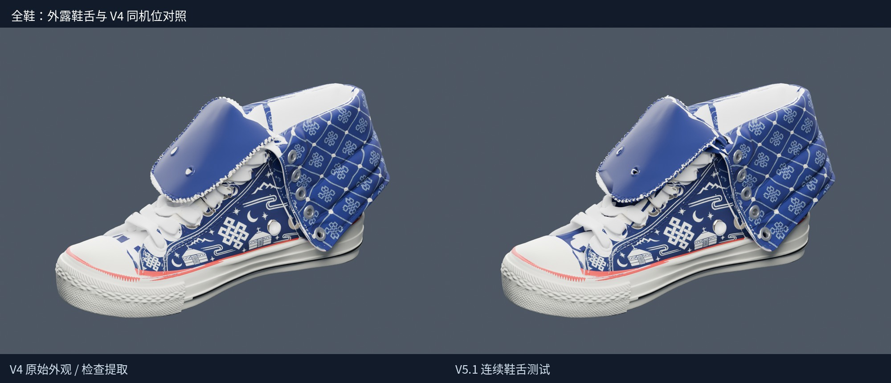
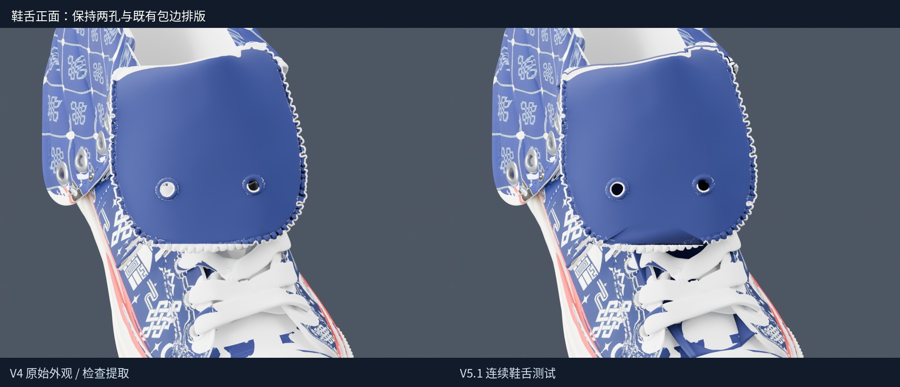
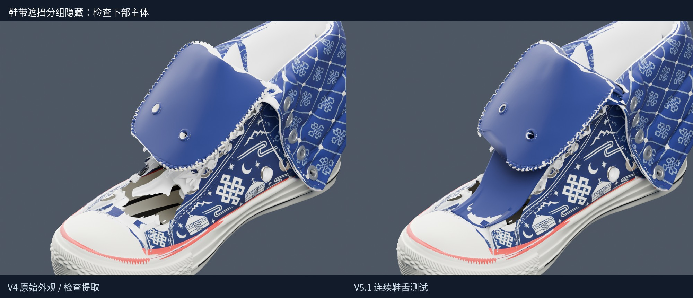
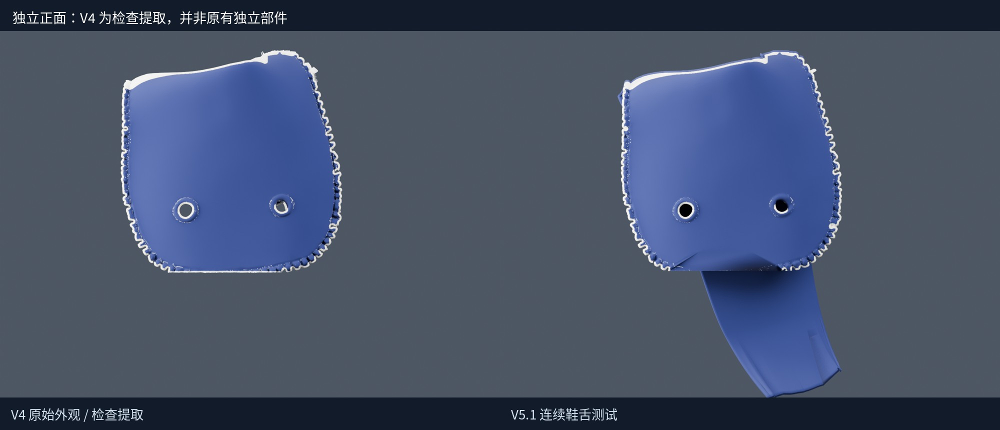
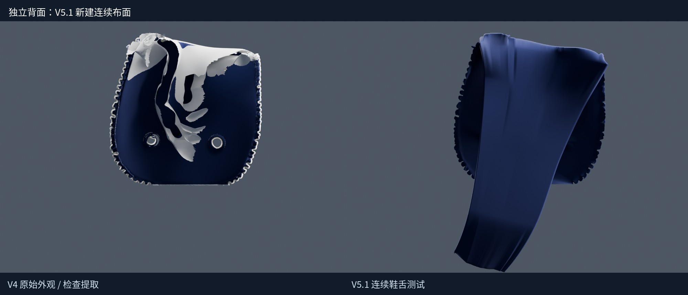
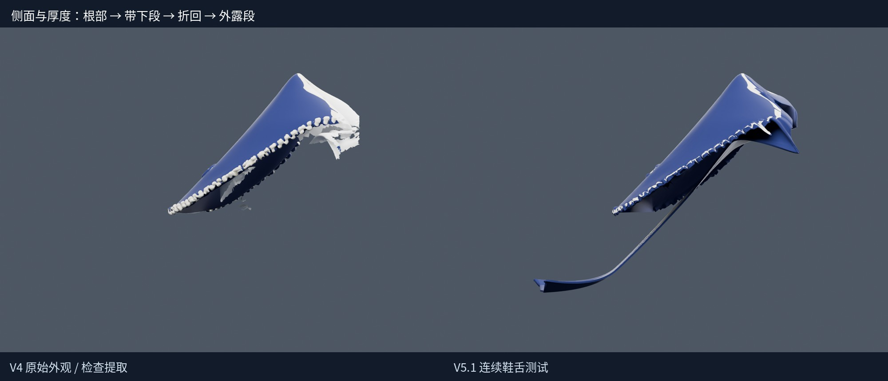
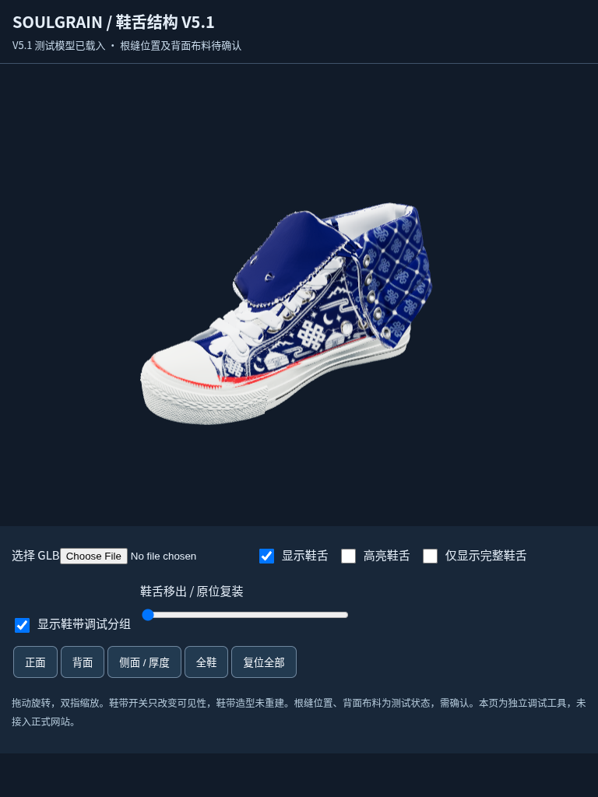

# Soulgrain Onward — V5.1 鞋舌结构重建测试报告

日期：2026-11-09（Asia/Shanghai）。本阶段只制作独立测试资产及本地调试工具；没有覆盖 V4，没有修改线上网站、现有动画或原始贴图，没有提交、推送、合并、部署。

## 1. 本轮交付与状态

已建立一个从喉口连接根部、鞋带下方主体，到上部折回与外露翻折段连续相连的鞋舌实体。正面、背面和厚度围边实际建模，两处 V4 既有孔保留。新鞋舌可作为完整部件高亮、显隐、移出及原位复装。

这是供确认的 V5.1 结构测试版。根缝的最终位置、背面布料规格仍有待确认；当前没有制作鞋舌展开动画或生产级骨骼绑定。现有鞋舌外露面使用重拓扑和原材质采样保留外观，不能描述为与 V4 每个三角面、每个外露 UV 坐标完全相同。

| 项目 | 文件 / 结果 |
| --- | --- |
| 完整测试鞋模 | output/SOULGRAIN-V5.1-tongue-structure-test.glb |
| 轻量单独鞋舌 | output/SOULGRAIN-V5.1-tongue-only.glb（约 5.4 MB，同一鞋舌几何） |
| 完整资产字节数 | 91738704 |
| 完整资产 SHA-256 | 27eec69e821417a75c3077789f5154d903e116fabe4fbe9d20e3a5596213ee12 |
| 只读 V4 SHA-256 | 64a95f4d579dc5bd221cbb50d06ebf5b89be2f1ec69eb18394ac9175a65f160d |
| 调试页 | viewer/index.html：JS 已内嵌，无需 CDN；可以选择本地 GLB |

已完整阅读上一轮 18 页审计报告对应 Markdown，提取 PDF 正文作复核，并核对问题坐标、语义候选数据、射线/剖面与相关分析脚本。原始审计区域仅用于定位，未把候选颜色边界直接当成制造裁片切线。输入哈希见 reports/input-manifest.json。

## 2. 鞋类结构与实际建模

| 结构区域 | 本轮实现 | 确认状态 |
| --- | --- | --- |
| 喉口根部 | 以现有鞋面前部的真实三角面为测试支撑，保存面 ID、重心坐标及连接点；布片根部与源面间距约 0.0003 模型单位 | 有几何贴合依据；工厂根缝位置待确认 |
| 鞋带下方主体 | 新建连续布面，向鞋口延伸；不使用一块独立三角板代替整条鞋舌 | 已建立 |
| 上部折回 | 在原外露段上边缘背后形成连续折回；折线约束在原轮廓内侧，避免额外抬高轮廓 | 测试折回，未来展开姿态仍需纠正形态 |
| 外露段 | 依据 V4 表面采样重建轮廓与曲面，保留两孔、蓝色及包边纹理分布 | 近似保留；微观包边形状需按对比图确认 |
| 正面与背面 | 同一个闭合壳体的两面，面朝向相反，围边连接 | 已建立 |
| 布料厚度 | 主体名义厚度 0.0055 模型单位；外露边线起伏附近局部较厚 | 未校准实际尺码，不擅自声称毫米值 |

根部是鞋舌与鞋面之间的装配/缝接锚定，不是把整条鞋舌焊成鞋身不可分离的一部分。独立移出属于调试演示；回到装配位后使用同一套连接坐标。未新增外露缝线或重画装饰。

## 3. 几何、法线与 UV 验证

| 检查 | 结果 |
| --- | --- |
| 鞋舌顶点 / 三角面 | 88,874 / 177,752 |
| 连通实体 | 1 |
| 闭合 / 绕序一致 | True / True |
| 边界边 / 非流形边 / 零面积面 | 0 / 0 / 0 |
| 保留孔数 / 拓扑属 | 2 / 2（两处既有贯穿孔） |
| 有限位置、法线、UV | True |
| 每个实际导出 Primitive 的零面积 UV | upperFront: 0, hiddenContinuousFront: 0, back: 0, rimSeparateUVIslands: 0 |
| 厚度内向射线采样 | 1800 点；小于 0.001 的短命中：0 |
| 20 次移出 / 复位误差 | 0 |

上述拓扑检测与射线采样是实际测试数据，但不是穷举所有三角面对的自相交证书。正背面、侧面和剖面均有截图；结构合格不能只靠“闭合网格”一项判断。源鞋身在鞋舌之外的旧退化面、内衬融合等问题保留，不在本轮顺带修复。

## 4. 原外观、图集和其他部件保护

| 保护项 | 实测 |
| --- | --- |
| 保留 V4 三角面、坐标、法线、原 UV | True |
| 鞋身两侧、翻筒、底部等保护区删除面数 | 0 |
| 原始 18 张图片字节完全一致 | True |
| 原始 10 个材质定义一致 | True |
| 10 个独立翻筒鞋眼未动 | True |
| 鞋带造型改动 | False |
| 旧鞋舌及必要局部移除面数 | 199139 |

外露鞋舌采用了新拓扑，因此建立独立 UV 图，并从 V4 颜色和金属度/粗糙度贴图逐点采样到鞋舌专用图集；不是对渲染画面拍照，也没有把光照烘进颜色，更没有复制鞋身或翻筒的纹样。原图集文件及 GLB 内原始图片全部保留。未改部位继续使用原始 UV；本报告不声称重建外露鞋舌仍逐顶点使用旧 UV。

新增隐藏主体与背面使用与 V4 蓝布相匹配的基础布材质及独立 UV，未杜撰新纹样。背面用料最终规格另列为待确认。原有包边的极细几何与采样后的表面可能有细微差异，应以同机位对比图检查。

## 5. 独立层级与调试操作

完整资产节点：Shoe_TEST_V3 / TONGUE_ASSEMBLY_V5_1 / GEO_TONGUE_CONTINUOUS_FRONT_BACK。鞋舌实体使用多个材质 Primitive 表达正面、隐藏主体、背面及围边，空间位置焊接分析仍为一个连续实体。ROOT 锚点：ANCHOR_TONGUE_ROOT_PROVISIONAL。

viewer/index.html 可进行鞋舌高亮、显示/隐藏、仅显示鞋舌、鞋带遮挡分组显隐、移出滑块和复位，以及正面、背面、侧面和全鞋视角。整页 JS 已内嵌，可使用本地文件选择器，不上传模型。若浏览器限制本地 HTML，使用本地 HTTP 服务打开本目录。该工具未接入正式网站，也没有公开部署。

鞋带开关是可见性调试分组，不是对原鞋带制造结构的完整拆解；与鞋带融合的局部遮挡面可能同时隐藏。分组只重排原三角面的显示归属，正常装配视图下形状、坐标、UV 不变。V4 下方仍存在未确认归属的旧融合白面，本轮没有把这些面全部猜作鞋舌并删除；独立鞋舌视图用于清楚验证新实体。

Chromium WebGL 软件渲染环境中，触摸/平板尺寸布局、显隐、高亮和 20 次移出复位测试已通过，无页面脚本错误。此结果不是实体 iPad Safari GPU 性能测试，不能据此承诺真实设备帧率。

## 6. 后续绑定准备与待确认项

新建带下布面使用有序纵横采样，根部和折线环、延伸参数及对应顶点保存在 data/tongue-rebuilt.npz；可据此制作骨骼权重和形态纠正。当前仅实现整体部件调试变换，没有声称已经完成展开/翻折动画。原孔位和包边附近仍需在后续绑定中做局部刚度及碰撞纠正。

| 待确认事项 | 当前处理 |
| --- | --- |
| 最终根缝位置 | 当前连接点贴合真实鞋面，但根线按现有喉口推定；保留 PROVISIONAL 标记 |
| 背面布料颜色、层数 | 暂用匹配 V4 的基础蓝布，无新装饰；不是工厂确认稿 |
| 包边细节 | 保留 V4 排版及原材质采样；重拓扑的微形状差异以对比图确认 |
| 旧鞋带/鞋口融合白面 | 保留未可靠归类部分；未把本轮扩大成内衬/鞋带重建 |
| 动态展开净空 | 本轮未实现展开动画；不能以当前终态代替所有中间姿态验证 |

## 7. 文件与复核

output/ 为独立测试 GLB；images/ 为同灯光实际渲染与 UV/剖面图；reports/validation.json 包含几何、UV、保护范围与源哈希验证；reports/viewer-validation.json 包含交互状态和 20 次复位结果；data/tongue-rebuilt.npz 保存规则主体、折线、根部锚点及源面对应；scripts/ 为本轮实现与检查脚本。

完整测试文件和单独鞋舌文件都内嵌所需贴图。原始 V4 与 A/B 不作为输出覆盖。本轮没有提交、推送、合并、部署；线上模型、相机、动画没有修改。
