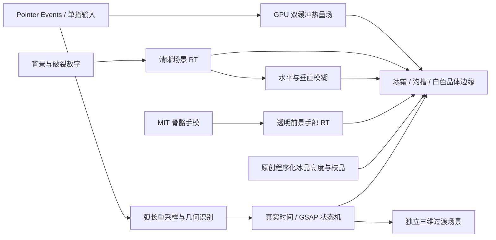

# Frost / 00 — Why Zero 开场独立技术研究 V1

范围到「加载倒数 → 数字破裂 → 冰面与绿色手势引导 → 用户画零 → 融化 → 独立过渡场景」为止。所有核心画面由 Three.js / WebGL / GLSL 实时绘制，GSAP 时间线随渲染时钟推进；主页面不播放视频替代交互。

**参考审计受限：原站和官方 Codrops 文章均被当前网络代理以 CONNECT 403 拦截，未读到文章正文、未取得原站运行画面。因此这是独立技术样板，不能声称完成原作逐帧视觉复刻。** 详见 [访问与技术审计](docs/AUDIT.zh-CN.md)。

## 预览阶段

同一个实现提供三个入口，不是三套互不对应的页面：

- `./?stage=core`：第一阶段，直接测试冰面绘制、几何识别与融化，不加载手部。
- `./?stage=hand`：第二阶段，冰晶材质、真实骨骼手部与绘制引导。
- `./`：完整 99 倒数与破裂开场，等待真实输入后解锁过渡场景。
- `./review.html`：实际运行截图、操作记录、验证报告与差距说明。

桌面按住鼠标左键画零；iPad / 手机用一根手指按住并绘制。起点与终点接近、整体较圆、沿同一方向绕完整一圈后，**松开**触发验证。顺时针和逆时针都可。直线、过小的圈、未闭合弧、三角形、方形、双圈和八字形不会解锁。

「重新开始」清理热量场、手势、旧时间线与结果。「跳过序幕」只跳过倒数，不会替用户完成手势。调试面板提供质量选择、真实帧间隔、最近识别指标、10 秒性能采样以及 JSON 导出。页面切到后台会暂停推进并取消当前绘制，回来继续；屏幕旋转会取消未完成的轨迹，避免混用两个坐标系。

## 实时渲染与状态



`FrostPipeline.ts`：清晰场景、手部、热量 ping-pong、两次模糊及最终合成；没有整鞋模型或既有 Soulgrain 模块依赖。热量场存储实际轨迹，邻域扩散控制沟槽软化；冰层色彩、法线、折射、白边和不规则融化前沿在最终 Shader 中计算。程序化纹理作为静态材料基础使用，动画始终由动态场与时间参数驱动。

`gesture.ts`：按弧长采样，PCA 归一化允许「零」呈椭圆；计算闭合距离、等周圆度、径向变异、总绕转角、方向一致性和尺寸。当前阈值是本研究自行选择，**没有声称还原官方阈值**。公开 12 类正负样例供复验。

`Narrative.ts`：明确状态、可取消的 GSAP 时间线与代次编号，防止重新开始后旧完成回调解锁。计时来自实际可见帧的时间差，不以帧数代替秒数。热量数值步长单独限幅以保持稳定。

`Countdown.ts`：十个字形只上传一次图集；两个数字由 uniform 取样。破裂使用真实三角碎片的独立中心、旋转、散开和消退，不是替换静态截图。

`GuideHand.ts`：公共 MIT 模型、25 个关节，重建关节父子链后独立制作握指姿态和食指画圈运动。它不是原站手模。资源 SHA-256 为 `291790c14f7f88a7f9bd35330c47392ed8e8d395ae6728f4bb7089f1bc1f2b96`，94,004 字节；完整许可见 `public/assets/HAND-LICENSE.txt`。

## 性能与 Safari

根据质量设置限制实际绘制像素数、DPR、热量场分辨率和程序化纹理尺寸。优先使用 16 位热量场，扩展不可用时回退 8 位；不依赖桌面专属输入。Pointer Capture 与预先设置的 `touch-action: none` 避免 Safari 把画零动作当成滚动。多指接触、取消和失去捕获都不会错误解锁。

开发验证环境为 Linux Chromium / SwiftShader、真实 CDP 鼠标和触控事件；触控为模拟。**尚未进行实体 iPad Safari 测试，不能把编码帧率或软件渲染帧间隔当成 iPad 性能结论。** 通过页面里的性能采样功能可在实际设备上导出数据。

## 仍存在的视觉差距

| 项目 | 当前实现与限制 |
|---|---|
| 原作构图、颜色与节奏 | 参考未能访问，尚无逐帧对照依据；当前为独立构图与配色 |
| 冰面 | 程序化高度、枝晶和分区折射；缺少经过艺术校准的摄影级微霜素材，颗粒和形态仍有程序化特征 |
| 沟槽与白边 | 实时热量场、折射和白色晶体环；不等同于真实流体/热力学模拟 |
| 晶体扩散 | 受噪声和角向分支调制的连续径向前沿，尚无体积冰屑与复杂多层散射 |
| 手部 | 1360 顶点通用手模，指节姿态与运动独立制作；皮肤微细节、腕部截面、接触与精修动作仍需美术工作 |
| 破裂数字 | 实际三角网格碎片，尚未加入厚度、真实裂纹传播和逐块立体断面 |
| 下一画面 | 自行设计的旋转玉绿色圆环与空间标题；不复刻原作后续叙事 |

## 构建与验证

```bash
cd studies/why-zero-intro
npm ci
npm test
npm run build
npm run dev
```

独立静态输出可用 `vite build --base /soulgrain-onward/why-zero-opening-study/ --outDir /tmp/why-zero-release --emptyOutDir` 生成。

```bash
node scripts/check-browser.mjs http://127.0.0.1:4760/
node scripts/check-browser.mjs http://127.0.0.1:4760/ --touch
node scripts/check-browser.mjs http://127.0.0.1:4760/ --touch --phone
```

测试使用实际输入，而不是私有成功 API。中间融化截图通过调试帧回调暂停一张已经绘制完成的真实帧，拍摄后恢复；没有注入蒙版 uniform。各阶段运行截图与 JSON 证据位于 `public/verification/`。

独立研究分支 `research/why-zero-intro-v1`，源文件仅增加在 `studies/why-zero-intro/`。Soulgrain 原模型、GLB、纹理、工作台及正式展示页保持原状；本研究不合并 main。

当前验证：12 类几何样例通过；桌面、平板和手机触控模拟各 13 项、共 39 项浏览器检查通过。审核视频 188 帧、12fps、15.667 秒。详见 verification/summary.json；没有将这些模拟检查表述为 Safari 实机验证。
